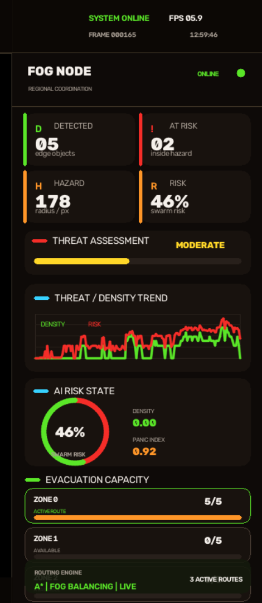
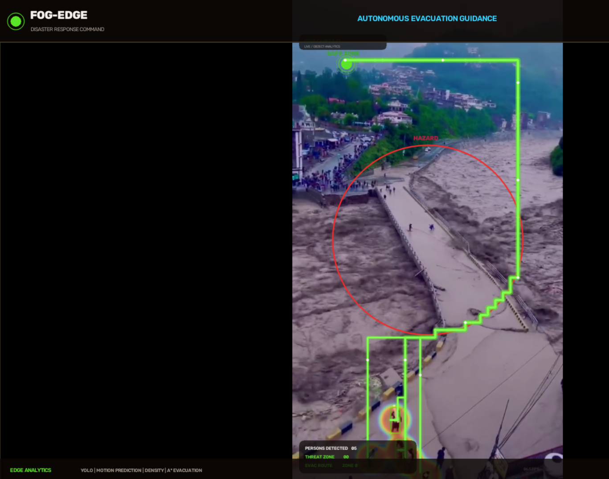
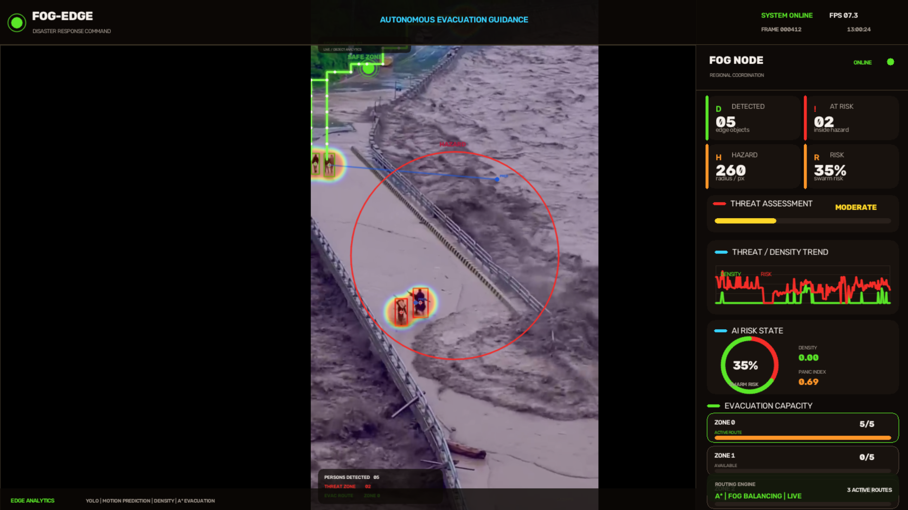
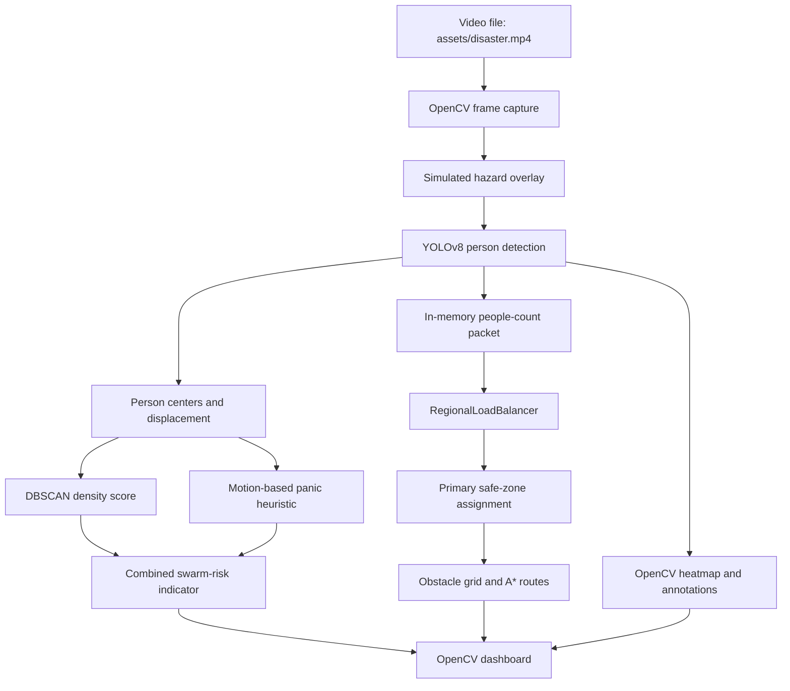

# Fog–Edge Adaptive Drone Evacuation Guidance System

A computer-vision-driven disaster-response prototype that detects people in video, estimates crowd and motion risk, assigns a simulated safe zone, and draws evacuation routes in an OpenCV command dashboard.

## The Problem

During floods, fires, earthquakes, and other emergencies, responders need a quick way to identify people in danger and reason about safer directions through a changing scene. This project explores that workflow by combining object detection and lightweight spatial heuristics in a video-based simulation.

The current implementation is a local prototype, not a deployed drone or a validated emergency-response product. Its technical contribution is an integrated demonstration loop that connects YOLO person detection, motion and density indicators, hazard overlays, simple fog-style zone assignment, grid-based A* routing, and live visualization. The separate modules also contain experiments in hazard classification, risk scoring, and survivor clustering; these are not all connected to the main loop.

## Project Outputs

### Edge Dashboard

The edge view presents the flood video with detected-person boxes, a simulated hazard boundary, a highlighted safe zone, a position heatmap, and route overlays. These are rendered by the OpenCV loop in `dynamic_simulation.py`.



### Fog Dashboard

The fog dashboard screenshot focuses on the regional coordination panel: detection and at-risk counts, hazard radius, a density and risk trend, a combined risk indicator, and simulated safe-zone capacity. These values come from the same local simulation; the panel does not represent a remote fog service or networked drone telemetry.



### Full System

The combined view places the video and route visualization alongside the coordination dashboard. It demonstrates the intended edge-to-fog presentation in one interface, rather than a physical or distributed deployment.



## Key Features

- **Person detection:** the main simulation runs the Ultralytics YOLOv8 nano checkpoint and keeps detections for the COCO `person` class.
- **OpenCV visual analysis:** video input, grayscale obstacle-grid construction, annotations, heatmap rendering, route drawing, and dashboard composition use OpenCV.
- **Crowd-density indicator:** DBSCAN groups detected-person center points; the largest cluster is converted to a capped score.
- **Motion and risk indicators:** frame-to-frame displacement feeds a heuristic panic index; density and average panic are combined into a displayed swarm-risk value.
- **Simulated hazard region:** a circular region is initialized at the frame center and expands to a fixed maximum radius. It is not detected from the video or a geospatial hazard feed.
- **A* evacuation routing:** a four-connected grid search routes from each detected person's grid cell to the currently assigned safe-zone cell.
- **Fog-style safe-zone assignment:** a local `RegionalLoadBalancer` distributes a packet's people count across configured capacities and sets a primary zone on the packet. This is an in-process simulation, not distributed fog computing.
- **Route and risk visualization:** the interface shows person boxes, motion projections, hazard and safe-zone markers, a position heatmap, route corridors, and summary trends.
- **Separate experiments:** hazard image classification, logistic-regression risk scoring, K-means clustering, and a second A* implementation exist as standalone modules or scripts; they are not all used by the dashboard.

## Technology Stack

| Technology | Purpose | Where it is used |
| --- | --- | --- |
| Python | Application and experiment code | All `.py` modules and scripts |
| Ultralytics YOLO | Person detection in the live simulation; optional standalone detection and training scripts | `dynamic_simulation.py`, `ml_modules/yolo_survivor.py`, `train_yolo.py` |
| OpenCV (`cv2`) | Video capture, image transforms, drawing, GUI, and heatmap/corridor rendering | `dynamic_simulation.py`, `visualization/` |
| NumPy | Coordinates, scores, heatmaps, and numerical calculations | `dynamic_simulation.py`, `intelligence/`, `fog/`, `ml_modules/`, `visualization/` |
| scikit-learn | DBSCAN density grouping, K-means clustering, and logistic regression | `intelligence/density_analyzer.py`, `ml_modules/clustering.py`, `ml_modules/risk_model.py` |
| PyTorch and Torchvision | Hazard CNN training and inference experiments | `ml_modules/hazard_cnn.py`, `test_hazard.py` |
| Pillow | Loading a hazard test image for CNN inference | `test_hazard.py` |
| Python standard library (`heapq`, `math`, `time`, `datetime`, `collections`) | Priority queue search, geometry, timing, timestamps, and history buffers | `navigation/astar_planner.py`, `ml_modules/astar_path.py`, `dynamic_simulation.py` |
| Mermaid | Source-controlled architecture diagram rendered by GitHub | This README |

There is currently no dependency manifest (`requirements.txt`, `pyproject.toml`, or equivalent). The package list in the installation section is inferred from source imports, not a pinned or tested lockfile.

## Architecture and Workflow

The main entry point is `dynamic_simulation.py`. Its actual per-frame flow is:

1. Open `assets/disaster.mp4` with OpenCV and initialize a simulated circular hazard and three fixed safe-zone coordinates.
2. Run YOLOv8 on the frame and retain boxes whose class is `person`.
3. Use each box center to estimate displacement from its previous observation, then compute a DBSCAN crowd-density score, a heuristic panic value, and the dashboard's combined swarm-risk value.
4. Send one in-memory packet containing the detected-person count to the regional load balancer, which returns a primary safe-zone assignment.
5. Apply a point-based heatmap, derive an obstacle grid from dark pixels and the circular hazard, and run A* from each detected person's grid cell to the assigned zone.
6. Draw the detections, hazard, safe zone, heatmap, route, and analytics dashboard using OpenCV.



The diagram describes one local Python process. The project does not currently implement network transport, edge/fog node discovery, drone-to-drone messaging, GPS coordinates, or hardware control.

## Algorithms and Implementation Status

| Component | Purpose, inputs, and processing | Output and status |
| --- | --- | --- |
| YOLOv8 detection | `dynamic_simulation.py` loads `yolov8n.pt`, processes each video frame at confidence `0.25`, and filters detections to COCO class ID `0`. | Person bounding boxes and center points used by the simulation. The main loop uses the pretrained nano checkpoint, not `runs/detect/train3/weights/best.pt`. |
| A* path planning | `navigation/astar_planner.py` receives a NumPy grid, a start and goal cell, and optionally a risk field. It considers four orthogonal neighbors, uses Manhattan distance, and adds a neighbor's risk value to each step cost when supplied. | A list of grid coordinates or an empty list when no route is found. The main loop calls this planner without `risk_field`, so its routes avoid blocked cells but are not weighted by the computed swarm-risk score. `ml_modules/astar_path.py` is a separate list-grid implementation using unit-cost moves. |
| Density analysis | `DensityAnalyzer.compute_density_score` takes detected-person center coordinates, fits DBSCAN (`eps=50`, `min_samples=3`), counts members in each non-noise cluster, and normalizes the largest cluster count by 10, capped at 1. | A rounded score and DBSCAN labels. Empty input returns score `0.0` and no labels. The main loop uses the score, not the cluster labels. |
| Motion / panic / swarm risk | `PanicPredictor` stores prior centers, calculates pixel displacement per processed frame, normalizes speed against 20 pixels per frame, and combines speed and density as `0.6 × speed + 0.4 × density`. The simulation adds a fixed boost for people inside the circular hazard. `SwarmAnalyzer` has a direction-instability method, but the main loop does not call it. | A per-person panic heuristic and a displayed value calculated as `0.5 × density + 0.5 × average panic`, clamped to `[0, 1]`. It is not a calibrated probability. |
| Hazard and risk assessment | The dashboard's active hazard is a growing circle around the frame center and point-in-circle distance checks. Separately, `fog/risk_field_generator.py` normalizes density, panic, and hazard matrices and combines them with configurable weights; `ml_modules/risk_model.py` fits logistic regression to six hard-coded synthetic examples. | The circle drives the main display and at-risk count. The risk-field generator and trained-on-dummy-data classifier are standalone experiments and are not called in the dashboard. The CNN in `ml_modules/hazard_cnn.py` is a training script for folder-labeled hazard images, not the main loop's hazard detector. |
| Safe-zone allocation | `RegionalLoadBalancer.balance` totals packet people, fills configured zones in descending capacity order, then assigns every packet the ID of the zone with the largest computed load. The main simulation supplies one packet and three zones with capacity five each. | Updated packet(s) and a stored zone-load dictionary. This is simple local capacity bookkeeping; it does not calculate routes to multiple destinations or distribute workloads across actual drones. |
| Survivor clustering | `SurvivorClustering` fits scikit-learn KMeans with a configured cluster count and fixed random state. | Cluster labels and centers, from supplied coordinates. It is demonstrated separately by `test_clustering.py`, not connected to the main loop. |

## Repository Structure

```text
.
├── assets/
│   └── screenshots/              # README demonstration screenshots
├── datasets/
│   ├── hazards/                  # ImageFolder-style hazard classes
│   └── survivor/                 # YOLO images and labels
├── fog/
│   ├── regional_load_balancer.py # In-memory zone capacity assignment
│   └── risk_field_generator.py   # Weighted normalized risk matrix experiment
├── intelligence/
│   ├── density_analyzer.py       # DBSCAN crowd-density score
│   ├── panic_predictor.py        # Displacement and panic heuristic
│   └── swarm_analyzer.py         # Direction instability and swarm score helpers
├── ml_modules/
│   ├── astar_path.py             # Standalone list-grid A*
│   ├── clustering.py             # KMeans survivor-coordinate clustering
│   ├── hazard_cnn.py             # Hazard CNN training script
│   ├── risk_model.py             # Logistic regression on synthetic examples
│   └── yolo_survivor.py          # Custom-checkpoint detection wrapper
├── models/
│   └── hazard_model.pth          # Local hazard CNN checkpoint, if supplied
├── navigation/
│   ├── astar_planner.py          # Grid A* with optional risk costs
│   └── safe_zone_optimizer.py    # Simple opposite-quadrant placement helper
├── simulation/
│   └── path_planner.py           # Empty placeholder
├── visualization/
│   ├── draw_corridor.py          # OpenCV route-line renderer
│   └── draw_heatmap.py           # Blurred point-density overlay
├── dynamic_simulation.py         # Main video simulation and dashboard
├── dynamic_tracking.py           # Empty placeholder
├── survivor.yaml                 # YOLO dataset configuration
├── train_yolo.py                 # YOLO training entry point
├── test_*.py                     # Small standalone module exercises
├── yolov8n.pt                    # Local YOLOv8 nano checkpoint, if supplied
└── yolo26n.pt                    # Additional local weight; not used by main loop
```

`dynamic_simulation.py` is the only implemented end-to-end video dashboard entry point. `dynamic_tracking.py` and `simulation/path_planner.py` are empty files. `navigation/safe_zone_optimizer.py` contains a basic coordinate helper, but the main loop instead initializes three fixed zones directly. `survivor.yaml` points to `datasets/survivor`; YOLO training expects its `train/images` and `valid/images` subfolders.

## Installation and Execution

### Requirements

- Python 3.10 or newer is recommended; the repository does not pin or declare a Python version.
- The main dashboard needs `opencv-python`, `numpy`, `ultralytics`, and `scikit-learn`.
- The video `assets/disaster.mp4` must exist locally. It is referenced by the program but is not part of the screenshot output.
- The main dashboard loads `yolov8n.pt` from the repository root. Ultralytics can fetch recognized official weights when absent, or place the intended checkpoint at that path before running.
- The local `.gitignore` excludes `*.mp4`, YOLO weight files, `runs/`, datasets, and model checkpoints. Therefore, a normal clone may not contain the runtime video, weights, dataset, or custom training output even though they exist in a development workspace. Supply or generate the needed artifacts locally.

### Windows PowerShell

```powershell
git clone https://github.com/Shabdh-05/fog-edge-drone-evacuation.git
cd fog-edge-drone-evacuation
py -3 -m venv .venv
.\.venv\Scripts\Activate.ps1
python -m pip install --upgrade pip
python -m pip install opencv-python numpy ultralytics scikit-learn
```

If PowerShell blocks environment activation, either use a permitted activation policy for your machine or invoke the environment's Python directly as `.\.venv\Scripts\python.exe` in the commands below.

Copy a compatible demonstration video to `assets\disaster.mp4` and ensure `yolov8n.pt` is available at the project root (or allow Ultralytics to download the official YOLOv8 nano weights when the model is first loaded). Then start the simulation:

```powershell
python dynamic_simulation.py
```

The program opens an OpenCV window. Press `Q` or `Esc` to exit, `F` to toggle fullscreen, and `Space` to pause or resume.

### Optional Experiments

Hazard CNN training and inference use PyTorch, Torchvision, and Pillow in addition to the core packages. Install a PyTorch build appropriate for your CPU/GPU from the official PyTorch installation selector, then install Pillow:

```powershell
python -m pip install pillow
```

`python ml_modules\hazard_cnn.py` trains the CNN using `datasets/hazards/train` and `datasets/hazards/validation`, then writes `models/hazard_model.pth`. `python test_hazard.py` expects that checkpoint and the hard-coded image `datasets/hazards/test/cyclone/500.jpg`; this exact sample filename must be present. YOLO training can be started with `python train_yolo.py` after the dataset paths in `survivor.yaml` are prepared; the script requests `device=0`, so it expects a supported GPU configuration. The custom detector in `ml_modules/yolo_survivor.py` expects `runs/detect/train3/weights/best.pt` specifically.

Small standalone exercises include `python test_astar.py`, `python test_clustering.py`, and `python test_risk.py`. There is no unified test runner or pinned dependency file at present.

## Limitations and Future Work

### Current Limitations

- This is a local video simulation and dashboard prototype, not software validated on physical drones or in field conditions.
- There is no GPS/geospatial map integration, drone flight controller, communications layer, or real fog/edge deployment.
- Hazard location and growth are synthetic parameters; the main pipeline does not classify or segment hazards from video.
- Detection uses a general pretrained YOLOv8 model with the COCO person class. No detection accuracy or real-world performance is reported here.
- Motion is estimated from detection-box object identity across frames rather than a dedicated persistent multi-object tracker, so identity continuity is not guaranteed.
- The main route grid is derived from grayscale image brightness plus the simulated hazard circle. It is a visual heuristic, not a surveyed traversability map; the active A* call does not use a risk field.
- Safe-zone allocation, density thresholds, and panic/risk formulas are simplified heuristics and are not validated for operational decisions.
- Several algorithms exist only as standalone experiments and are not integrated into the main simulation, as noted above.
- Dependencies, Python version, and large runtime assets are not locked or fully documented by project manifests; cloning alone may not reproduce the local demo.

### Possible Future Work

- Add a pinned dependency manifest, documented Python version, and a small reproducible sample-video setup.
- Replace brightness-based routing with a map or segmentation-derived traversability and explicitly integrate spatial risk costs.
- Add robust persistent tracking and calibrated density, panic, and hazard models, with evaluation data and measured results.
- Implement real geospatial safe zones, capacity-aware per-group allocation, and route validation.
- Separate edge perception from fog coordination behind an explicit network/API boundary, then evaluate latency and failure behavior.
- Add automated tests for routing, capacity allocation, and the video-to-dashboard integration.

## License and Attribution

No license or external asset attribution file was found in the project root. Add the appropriate license and document the provenance and usage rights for the video, datasets, and model weights before redistributing them.